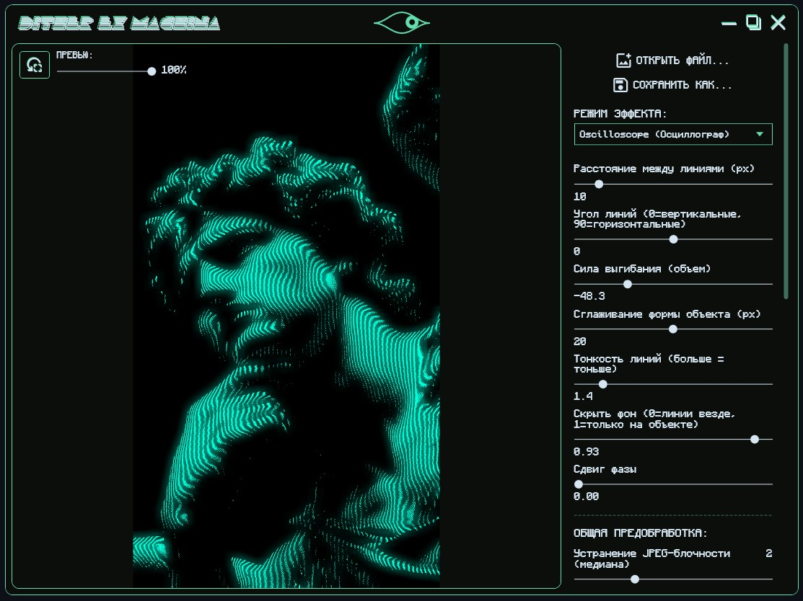
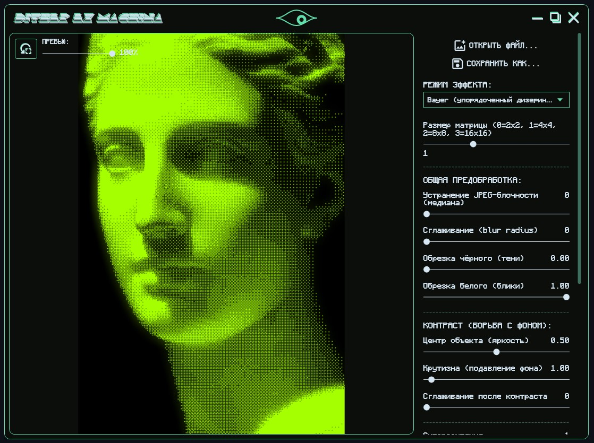
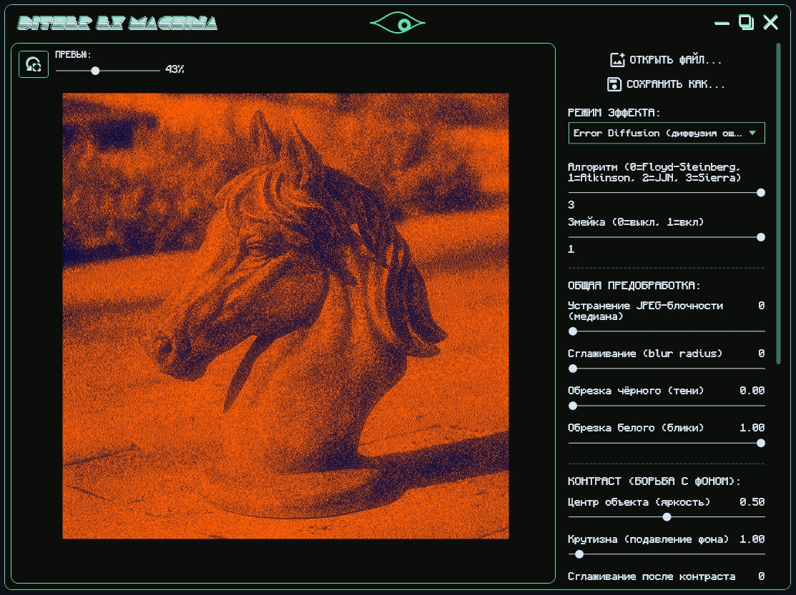
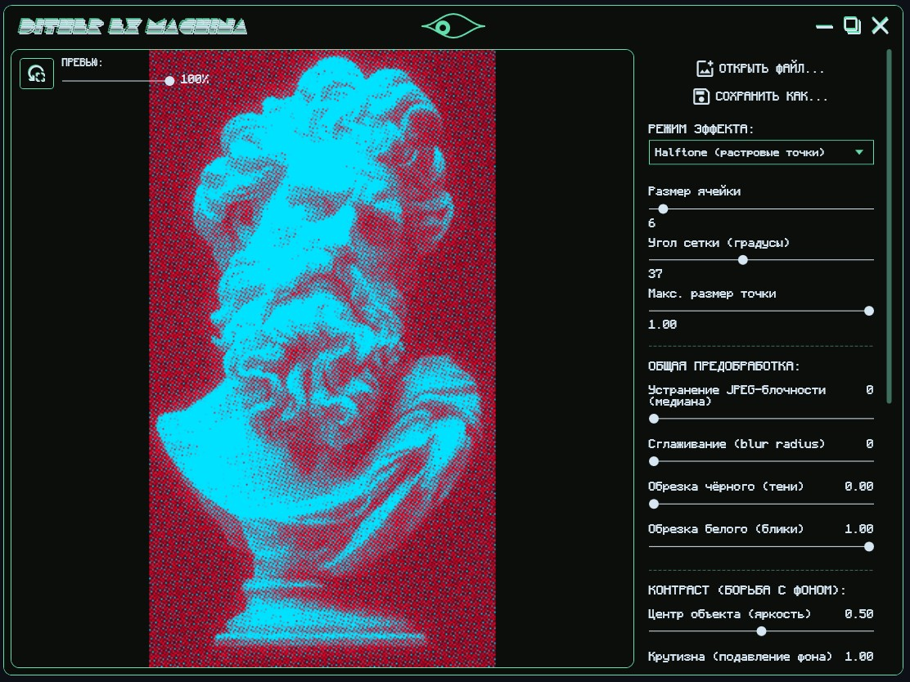
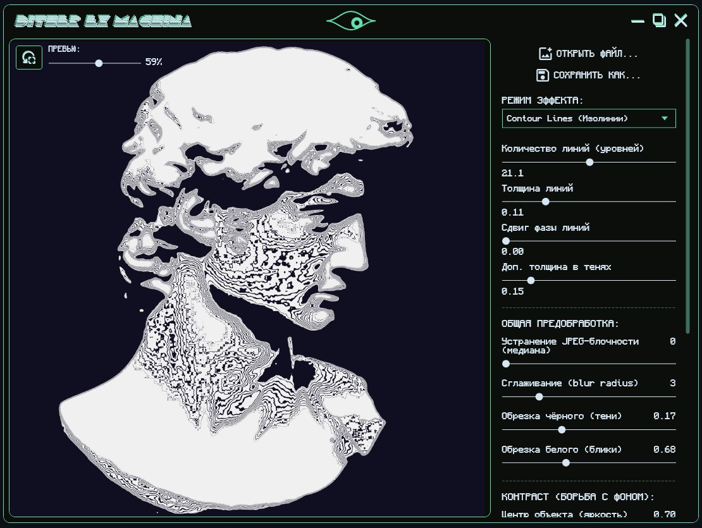
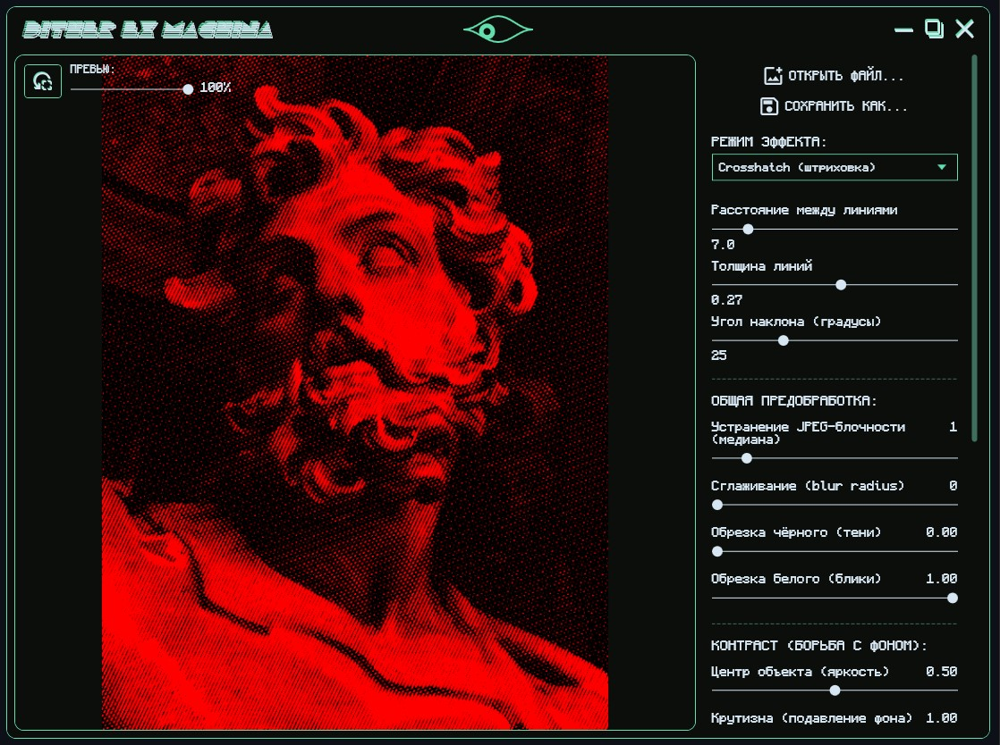
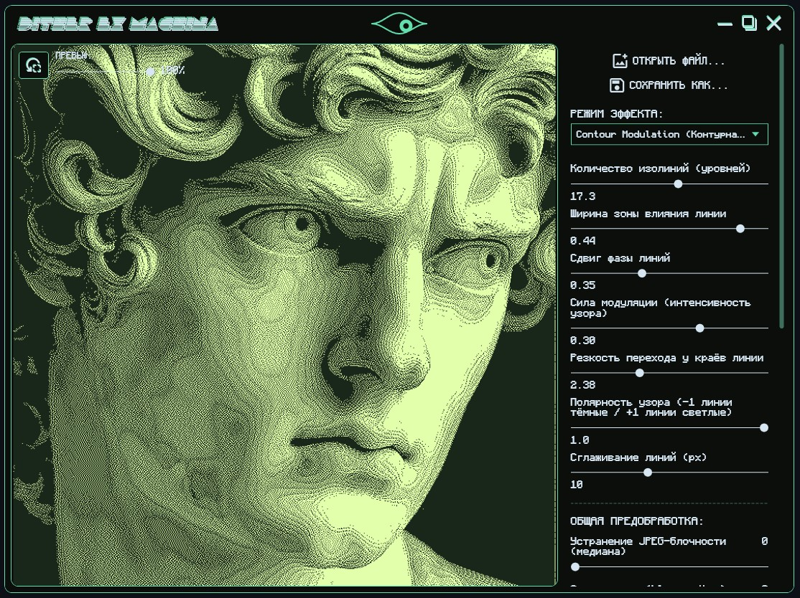

# Dither Ex Machina

**English** · [Русский](README.ru.md)

[](https://github.com/kiraping1337/dither-ex-machina/releases)

> A **WPF (.NET)** desktop application for processing images with various dithering and stylization algorithms.

## About the project

**Dither Ex Machina** is an application that uses various dithering algorithms to turn ordinary images into stylized versions of the originals.

The preview updates as you drag sliders and gradient stops. If a frame takes a long time to render, the application can temporarily lower the preview resolution. When you release the slider, the preview returns to the selected resolution.

The project was designed with a focus on clean architecture and extensibility. Each effect is a separate module, making it easy to add effects to the system without changing the existing logic.

---

## Features

- 📂 Load images
  - PNG
  - JPG / JPEG
  - BMP
  - WebP

- 🔧 Multiple image processing algorithms
  - Bayer Dithering
  - Error Diffusion
  - Halftone
  - Crosshatch
  - Contour Lines
  - Contour Modulation
  - Oscilloscope

- 🎴 Adjustable gradient map and Glow effect

- ⚙️ Adjust the settings for each effect

- 👀 Preview the result

- 🌐 Switch between English (the default) and Russian using the EN / RU switch

- 💾 Save the processed image at its original resolution
  - PNG
  - JPEG
  - BMP
  - WebP

---

## Algorithms

### Oscilloscope

This effect uses the image’s brightness map to distort a grid of parallel lines, creating a three-dimensional relief.

The result resembles oscilloscope traces, CRT displays, and retrofuturistic 3D scans.

## 

### Bayer Dithering

Classic ordered dithering using a Bayer matrix.

A regular arrangement of pixels gives the image a distinctive retro look.

You can choose a 2×2, 4×4, 8×8, or 16×16 matrix.

## 

### Error Diffusion

The error diffusion algorithm distributes quantization error among neighboring pixels.

You can choose from the Floyd–Steinberg, Atkinson, Jarvis–Judice–Ninke, and Sierra algorithms.



---

### Halftone

This effect simulates a printed halftone using dots of varying sizes.

The result resembles the images used in comics and manga.



---

### Contour Lines

This effect turns the image into a set of contour lines that highlight changes in brightness.

The result resembles a topographic map.



---

### Crosshatch

This effect creates an image using strokes of varying density.



---

### Contour Modulation

This effect incorporates lines of equal brightness into the dither pattern by varying the quantization threshold along the subject’s contours.

The result resembles printed designs on banknotes and illustrations in books.



## Project structure

```
dither-ex-machina
│
├── Controls/      # Custom UI controls
├── Fonts/         # Fonts
├── Effects/       # Dithering effect implementations
├── Models/        # Data models
├── Rendering/     # Image processing core
├── Utils/         # Helper classes
│
├── MainWindow.xaml
├── MainWindow.xaml.cs
├── App.xaml.cs
└── App.xaml
```

---

## Technologies used

- C#
- WPF
- .NET 10
- XAML
- SkiaSharp

---

## Architecture

Each effect implements a common image processing interface. This has three benefits.

- Effects are independent of one another.
- New algorithms are easy to add.
- The user interface automatically displays the settings for the selected effect.

The main image processing logic is separate from the user interface, making the project easier to maintain and extend.

---

## How to build the project

### Requirements

- Windows and the .NET 10 SDK.
- To work in Visual Studio, use Visual Studio 2026 (18.0 or later) with the **.NET desktop development** workload. [Microsoft requirements](https://learn.microsoft.com/en-us/dotnet/core/install/windows)

### Run

```powershell
git clone https://github.com/kiraping1337/dither-ex-machina.git
cd dither-ex-machina
dotnet run --project ./dither-ex-machina/dither-ex-machina.csproj -c Release
```

To run from Visual Studio, open `dither-ex-machina.sln` and press `F5`.
